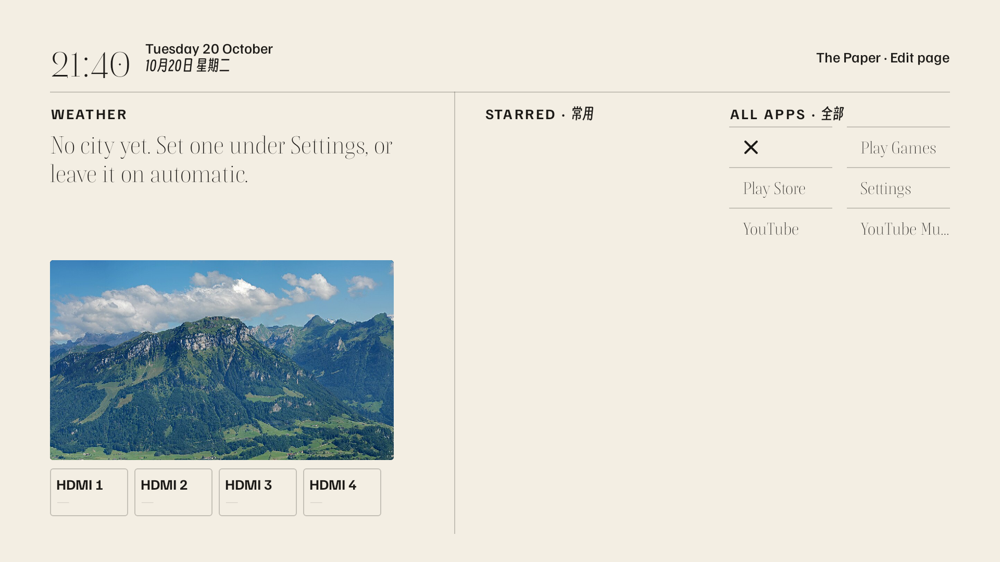
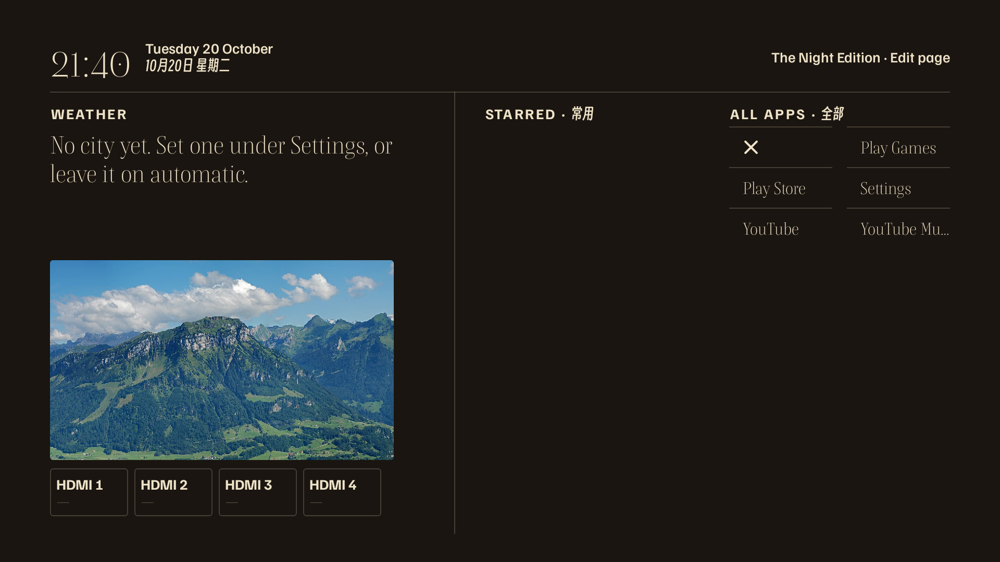
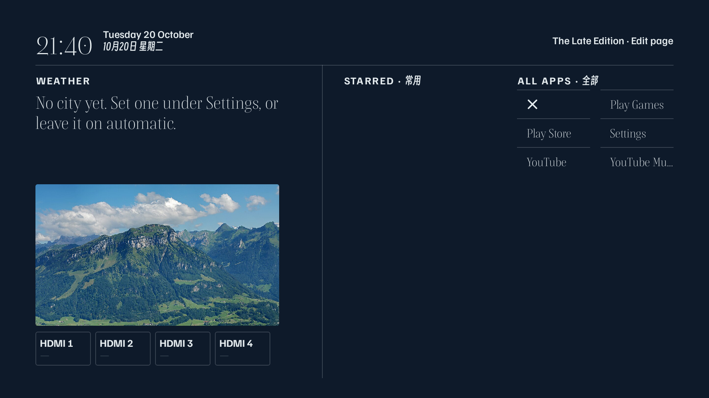

# Clean Launch

Clean Launch is a home screen for Android TV. The remote is the D-pad. OK opens the focused app, HDMI port, or settings row. Back steps out of a menu, then a panel, then Settings, then home.

The page is a newspaper: the time and the date, weather when a city is known, one photograph, HDMI 1–4, up to six pinned apps, and the rest of the apps on the set. Nothing is filled in for you. There is no default city and no default ticker list.

Three themes ship with it.







The screenshots are from an emulator with the bundled sample photograph, no city, and no ticker symbols.

## Features

- D-pad only. OK launches. Hold OK on a home app to open its row in Settings.
- Paper, Night Edition, and Late Edition. The dim clock uses the same layout on each, with the time and the weather line.
- Weather from Open-Meteo, then wttr.in, after a city is known.
- Tickers for symbols you type. The row shows the last price and the day's percent, three symbols at most. Quotes come from Tencent, then Sina.
- Photographs from a folder on the television, cross-fading on an interval you choose.
- HDMI tiles. Tile 1 opens port 1. The label comes from the television. AV and the tuner stay hidden until Settings shows them.
- An index of the launchable apps on the set. Pin, rename, hide, or reorder them from Settings. A bundled X opens https://x.com. No other site shortcuts are bundled.
- A dim clock after idle. Any key wakes it.

Package id: `app.cleanlaunch.tv`.

## Install

The debug APK is signed with the Android debug keystore. There is no release key in this tree.

```sh
./gradlew assembleDebug
adb install -r app/build/outputs/apk/debug/app-debug.apk
```

JDK 21 and an Android SDK with compile SDK 35. `local.properties` should set `sdk.dir`. That file is not part of the repository.

## Set as home

On the television: Settings, Apps, Clean Launch, and open it as the home screen. From a computer:

```sh
adb shell cmd package set-home-activity app.cleanlaunch.tv/.MainActivity
```

If the set still returns to the stock launcher, give Clean Launch the Home role:

```sh
adb shell cmd role add-role-holder android.app.role.HOME app.cleanlaunch.tv
```

## Photographs

The slot reads `/sdcard/Android/data/app.cleanlaunch.tv/files/photos/`. The folder is created on first run and needs no storage permission. JPG, PNG, and WEBP are shown as they are. HEIC is converted by the script when `sips` is available.

An empty folder shows one sample: Fronalpstock, a mountain above Lake Lucerne, photograph by Lukas Schlagenhauf, CC0, via Wikimedia Commons. The card does not print the file name.

Push a folder only after you name the device. The script has no default address.

```sh
TV=<ip>:5555 scripts/push-photos.sh <folder>
```

Settings, Front page, Photographs sets the interval to 5 seconds, 10 seconds, 30 seconds, 1 minute, or 5 minutes. The default is 5 seconds. The change cross-fades over 600 ms.

## Settings

Open Settings from the top of the home page, or hold OK on an app.

- **Inputs.** Rename a port, hide or show it, or test it. Tile N opens physical port N.
- **Apps.** OK on a row opens Pin or Unpin, Rename, Hide or Show, and Move. Up and Down reorder while a row says Moving. Six apps can be pinned.
- **Front page.** City (a blank name returns to automatic), weather, ticker symbols, the photograph interval, two custom lines, and whether weather and stocks are shown. News is not on the front page.
- **Look.** Paper, Night Edition, or Late Edition. Focus previews a theme. OK keeps it.
- **Screen saver.** Dim after a number of minutes, or off. The dim page is the time and the weather on a dark gradient.
- **About.** Version and the typefaces.

## Privacy

Clean Launch has no account, no analytics, and no ads. It does not use Google Play services.

A city you type stays on the television. Automatic mode asks a public IP service (ip-api.com, then ipinfo.io, then api.ip.sb) for a city, and uses it only when that city agrees with the television's timezone or country. If it does not agree, the weather block stays empty.

Weather requests go to Open-Meteo and, if that fails, wttr.in. Quote requests go to Tencent and, if that fails, Sina, and only for symbols you typed. Photographs stay in the app folder. Nothing in the app is uploaded to the author.

## License

MIT. See [LICENSE](LICENSE).

Newsreader and Familjen Grotesk are under the SIL Open Font License. Smiley Sans is under the SIL Open Font License. Boska is under the Indian Type Foundry Font License, bundled for this app. Those license texts are in `app/src/main/assets/`.

## Build

```sh
./gradlew testDebugUnitTest assembleDebug
```

A GitHub Actions file that builds the debug APK on tags named `v*` is at [docs/ci/release-apk.yml](docs/ci/release-apk.yml). Copy it to `.github/workflows/release-apk.yml` if you want that check. It uses the runner's debug keystore and no secrets.
